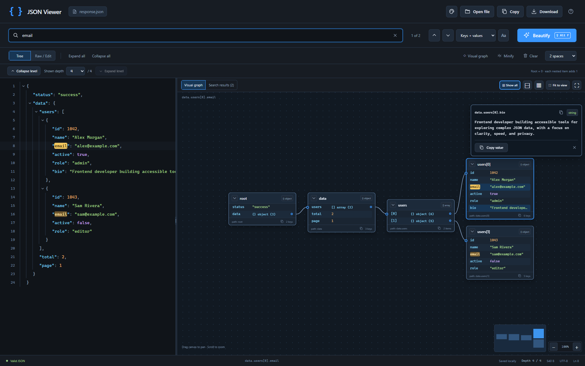
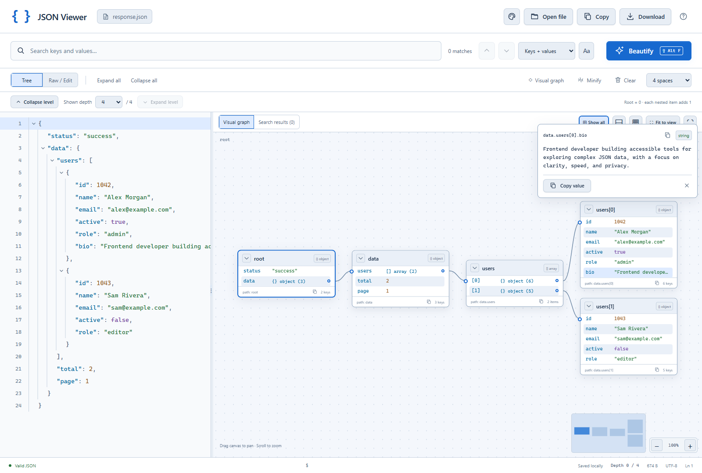

# Pro JSON Viewer — نمایشگر JSON

**[English](README.md)** · **[راهنمای نصب خیلی ساده](INSTALL.fa.md)** · [راهنمای کامل امکانات به انگلیسی](docs/USER_GUIDE.md)

JSON را جست‌وجو، مرتب و به شکل درخت و نمودار ببینید؛ در یک صفحهٔ کامل یا پنل کوچک کنار آیکون کروم. بدون حساب کاربری و بدون سرور.

**[دانلود مستقیم آخرین نسخهٔ آمادهٔ نصب](https://github.com/asgarihope/pro-json-viewer/releases/latest/download/pro-json-viewer.zip)**

<!-- release-version:start -->
نسخهٔ فعلی: **1.6.0** · [دانلود همین نسخه](https://github.com/asgarihope/pro-json-viewer/releases/download/v1.6.0/pro-json-viewer-v1.6.0.zip)
<!-- release-version:end -->

فقط فایل ZIP بالا را لازم دارید. برای نصب نیازی به سورس پروژه، Git، Node.js، Python یا اجرای دستور ندارید. فعلاً نصب از پوشه انجام می‌شود و افزونه در فروشگاه کروم منتشر نشده است.

## نصب در شش قدم

1. روی **دانلود مستقیم آخرین نسخهٔ آمادهٔ نصب** در بالا کلیک کنید.
2. روی ZIP دانلودشده راست‌کلیک کنید ← **Extract All…** ← **Extract**. پوشهٔ استخراج‌شده را در جایی همیشگی مثل Documents بگذارید.
3. در **نوار آدرس بالای کروم** بنویسید `chrome://extensions` و Enter بزنید.
4. کلید **Developer mode** را در بالای سمت راست روشن کنید.
5. روی **Load unpacked** کلیک کنید. داخل پوشهٔ استخراج‌شده بروید، پوشهٔ **`pro-json-viewer` که فایل `manifest.json` داخلش است** را انتخاب کنید و **Select Folder** را بزنید. خود پوشه را انتخاب کنید؛ نه ZIP و نه فایل JSON.
6. روی آیکون قطعهٔ پازل کروم کلیک کنید ← کنار **JSON Viewer — Search & Beautify** سنجاق را بزنید ← روی آیکون `{ }` افزونه کلیک کنید.

پنل کوچک آماده است. برای صفحهٔ کامل روی **Open in full viewer** در بالای سمت راست پنل بزنید. JSON را در **Raw / Edit** بچسبانید و **Beautify** را بزنید. برای امتحان بدون فایل، **Example** را انتخاب کنید.

برای رفع مشکل یا به‌روزرسانی، [راهنمای نصب ساده](INSTALL.fa.md) را ببینید. پوشهٔ استخراج‌شده را بعد از نصب پاک یا جابه‌جا نکنید؛ کروم افزونه را از همان‌جا اجرا می‌کند. مراحل مطابق [راهنمای رسمی نصب افزونهٔ unpacked کروم](https://developer.chrome.com/docs/extensions/get-started/tutorial/hello-world#load-unpacked) هستند.

## امکانات

- جست‌وجوی متن در کلیدها، مقدارها یا هردو؛ حساسیت به بزرگی حروف، هایلایت و حرکت میان نتایج.
- مرتب‌سازی و فشرده‌سازی بدون تغییر داده؛ درخت باز و بسته‌شونده، نمایش عمق و بازشدن مرحله‌ای سطح‌ها.
- نمایش بصری آبجکت و آرایه؛ نودهای پیش‌فرض بسته، هر عمق در یک ستون، جابه‌جایی با موس، زوم، مینی‌مپ و نمایش متراکم همهٔ نودها.
- بازشدن و مرکز شدن با انیمیشن، نمایش مقدار کامل، دکمهٔ کپی مقدار و مسیر، و کپی مسیر با راست‌کلیک روی کلید.
- انتخاب عادی متن و Ctrl/Cmd+C، حتی هنگام انیمیشن و تغییر تم.
- شش تم ذخیره‌شونده: تیره، روشن، اقیانوسی، جنگلی، بنفش و سپیا.
- بازکردن و کشیدن فایل، دانلود JSON، ذخیرهٔ پیش‌نویس و پنل سریع کنار آیکون کروم.





## حریم خصوصی و محدودیت‌ها

تنها دسترسی افزونه `storage` است. JSON، پیش‌نویس و تم در پروفایل مرورگر خودتان ذخیره می‌شوند. افزونه درخواست شبکه یا ابزار رهگیری ندارد و به سایت‌ها یا تاریخچهٔ مرورگر دسترسی ندارد. این یک محیط مستقل برای JSON است و پاسخ‌های JSON سایت‌ها را خودکار جایگزین نمی‌کند.

شکل اصلی عددها، عددهای بزرگ، منفی صفر، کلیدهای تکراری، ترتیب کلیدها و escapeهای رشته حفظ می‌شوند. سقف هر سند ۵ مگابایت، عمق تو‌در‌تویی ۲۵۶ و تعداد نتایج جمع‌آوری‌شدهٔ هر جست‌وجو ۱۰٬۰۰۰ است. فهرست نتایج تا ۲۵۰ مورد را نشان می‌دهد و دکمه‌های بعدی/قبلی میان همهٔ نتایج جمع‌آوری‌شده حرکت می‌کنند. اگر جست‌وجو خیلی کلی بود، متن دقیق‌تری وارد کنید.

## برای توسعه‌دهندگان و نگه‌دارندگان

سورس قابل نصب در پوشهٔ [`extension/`](extension/) است. مستندات و تست‌ها بیرون از آن هستند. ZIP انتشار فقط افزونه و دو راهنمای نصب را دارد. افزونه به کامپایل یا وابستگی زمان اجرا نیاز ندارد.

```sh
npm test
python -m unittest discover -s tests -p "test_*.py"
python scripts/build.py
```

بیلد، پوشهٔ دقیق قابل انتخاب در کروم یعنی `dist/pro-json-viewer/`، فایل ثابت `dist/pro-json-viewer.zip`، فایل ZIP نسخه‌دار و SHA-256 را می‌سازد. تست مرورگر ابزار توسعه است؛ [راهنمای مشارکت](CONTRIBUTING.md)، [گزارش بررسی‌ها](docs/VERIFICATION.md) و [روش انتشار](docs/RELEASING.md) را ببینید.

برای انتشار جدید، `python scripts/prepare_release.py X.Y.Z` را اجرا کنید، تغییرات را بررسی و کامیت کنید و تگ `vX.Y.Z` را push کنید. GitHub Actions تست و بیلد می‌گیرد و ZIP نصب را منتشر می‌کند. لینک اصلی دانلود همیشه به آخرین انتشار می‌رسد. اسکریپت آماده‌سازی، لینک نسخهٔ مشخص را در **هر دو README و هر دو راهنمای نصب** عوض می‌کند؛ بیلد در صورت لینک قدیمی یا ناهماهنگی نسخه‌ها خطا می‌دهد.

## هدف پروژه، پیاده‌سازی فنی و پول ریکوئست

**هدف:** جست‌وجو و فهم سریع JSON همراه با حفظ دقیق داده و انتخاب عادی متن؛ در پنل سریع و صفحهٔ کامل بصری.

**پیاده‌سازی:** JavaScript به‌صورت ES module، HTML/CSS و Manifest V3. فایل `core.js` متن اصلی را اعتبارسنجی و توکن‌بندی می‌کند تا مرتب‌سازی و جست‌وجو داده را تغییر ندهد. `graph-model.js` چینش ستونی عمق‌ها، `graph-motion.js` انیمیشن چینش و دوربین، و `graph.js` کارت‌های DOM مجازی‌شده و خطوط و مینی‌مپ canvas را مدیریت می‌کنند. `app.js` ردیف‌های متن را دوباره استفاده می‌کند تا انتخاب متن نپرد. `themes.js` و `storage.js` تم و پیش‌نویس را در `chrome.storage.local` ذخیره می‌کنند. ابزار انتشار فقط از کتابخانهٔ استاندارد Python استفاده می‌کند.

**پول ریکوئست:** مشکل قابل مشاهده و رفتار بعد از تغییر، قسمت‌های تغییرکرده و نتیجهٔ بررسی‌ها را بنویسید. برای تغییر رابط، تصویر قبل و بعد بگذارید. تغییر دسترسی، داده، محدودیت یا مهاجرت را توضیح دهید. هرجا مرتبط است انتخاب متن، دقت عددها، پنل کوچک، نمودار و reduced motion را بررسی کنید. از [قالب PR](.github/pull_request_template.md) و [راهنمای مشارکت](CONTRIBUTING.md) استفاده کنید. JSON شخصی، پروفایل مرورگر، وابستگی‌ها و خروجی `dist/` را کامیت نکنید.
