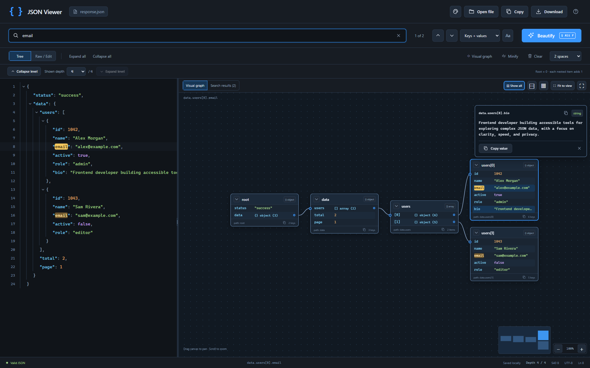
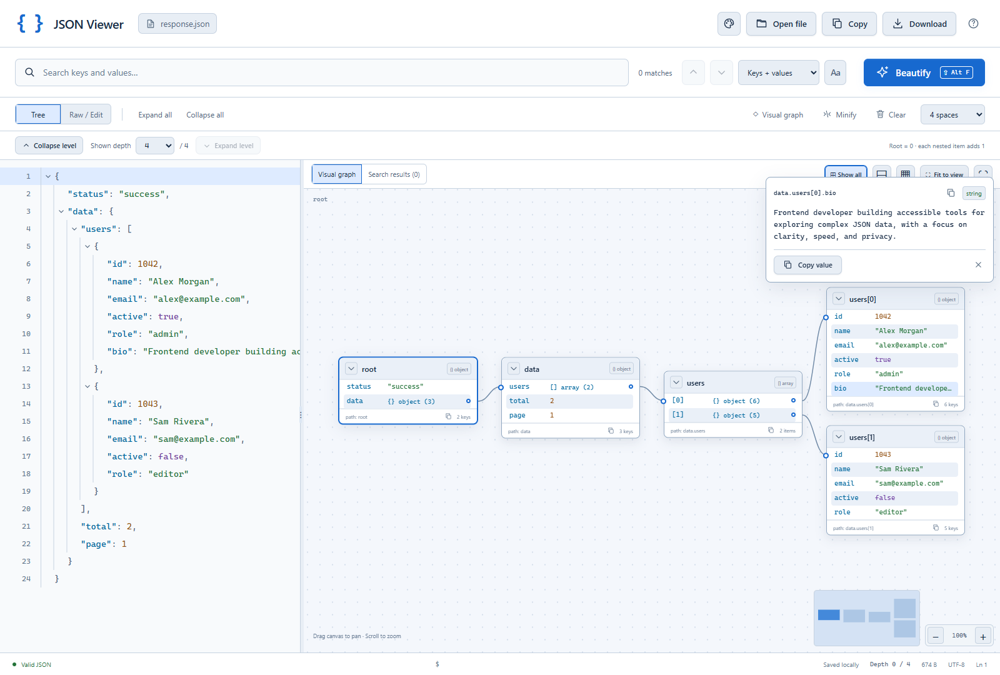

# Pro JSON Viewer

**[فارسی](README.fa.md)** · **[Easy installation](INSTALL.md)** · [User guide](docs/USER_GUIDE.md)

Search, beautify, and explore JSON in a Chrome tab or a small toolbar popup. Runs locally, without an account or server.

**[Download the latest ready-to-install ZIP](https://github.com/asgarihope/pro-json-viewer/releases/latest/download/pro-json-viewer.zip)**

<!-- release-version:start -->
Current version: **1.6.0** · [Download this version](https://github.com/asgarihope/pro-json-viewer/releases/download/v1.6.0/pro-json-viewer-v1.6.0.zip)
<!-- release-version:end -->

You only need the ZIP above. You do not need the source-code ZIP, Git, Node.js, Python, or a terminal to install it. This is an unpacked extension; it is not listed in the Chrome Web Store.

## Install in six steps

1. Click **Download the latest ready-to-install ZIP** above.
2. Right-click the downloaded ZIP → **Extract All…** → **Extract**. Move the extracted folder somewhere permanent, such as Documents.
3. In Chrome, type `chrome://extensions` into the **address bar at the very top**, then press Enter.
4. Turn on **Developer mode** at the upper right.
5. Click **Load unpacked**. Open the extracted folder, select the **`pro-json-viewer` folder that contains `manifest.json`**, then click **Select Folder**. Select the folder, not the ZIP or the JSON file.
6. Click Chrome's puzzle-piece icon → pin **JSON Viewer — Search & Beautify** → click its `{ }` icon.

The small popup is ready. Click **Open in full viewer** at its upper right for the full workspace. Paste JSON in **Raw / Edit**, then click **Beautify**. Use **Example** to try it without a file.

Need help or updating an older copy? [Follow the simple installation guide](INSTALL.md). Keep the extracted folder after installing: Chrome loads the extension from that location. These steps follow [Chrome's unpacked-extension instructions](https://developer.chrome.com/docs/extensions/get-started/tutorial/hello-world#load-unpacked).

## What it does

- Literal search in keys, values, or both; case matching, highlighted results, and next/previous navigation.
- Lossless beautify/minify, collapsible source tree, depth indicator, and one-level-at-a-time expansion.
- Visual object/array cards: closed by default, one column per depth, draggable objects, pan, zoom, minimap, and compact Show all.
- Animated expansion and centering, full-value panels, copy value/path buttons, and right-click attribute-path copying.
- Native text selection and Ctrl/Cmd+C, including during graph motion and theme changes.
- Six saved themes: Midnight, Daylight, Ocean, Forest, Plum, and Sepia.
- Open/drop files, download JSON, saved draft, and a quick toolbar popup.





## Privacy and limits

The only extension permission is `storage`. JSON, draft, and appearance settings stay in your browser profile. The extension sends no network requests, has no telemetry, and cannot read websites or browsing history. It is a dedicated workspace; it does not automatically replace JSON responses on websites.

Formatting preserves original numeric spellings, large integers, negative zero, duplicate keys, key order, and escaped strings. Limits are 5 MiB per document, 256 nested levels, and 10,000 collected matches per query. The results list shows up to 250 matches; navigation traverses all collected matches. Narrow a broad query if needed.

## For contributors and maintainers

The installable source is in [`extension/`](extension/). Development files and tests stay outside that folder. The release ZIP contains only the extension and two installation guides. No compilation or runtime dependency is needed.

```sh
npm test
python -m unittest discover -s tests -p "test_*.py"
python scripts/build.py
```

The build creates `dist/pro-json-viewer/` (the exact folder Chrome loads), a stable `dist/pro-json-viewer.zip`, a versioned ZIP, and SHA-256 checksums. Browser regression tests are optional development checks; see [CONTRIBUTING.md](CONTRIBUTING.md). See [verification evidence](docs/VERIFICATION.md) and [release instructions](docs/RELEASING.md).

For a new release, run `python scripts/prepare_release.py X.Y.Z`, review and commit its changes, then push tag `vX.Y.Z`. GitHub Actions tests, builds, and publishes the install-only ZIP. The primary download link always resolves to the latest published release. The preparation script updates the explicit version links in **both READMEs and both installation guides**; the build rejects stale links or mismatched versions.

## Project purpose, technical implementation, and pull requests

**Purpose.** Make searching and understanding JSON fast while preserving its exact data and native text selection. Both a quick popup and a full visual workspace serve this goal.

**Implementation.** Plain JavaScript ES modules, HTML/CSS, and Manifest V3. `core.js` validates and tokenizes the original JSON for lossless formatting and search. `graph-model.js` lays out containers in depth columns; `graph-motion.js` interpolates layout and camera movement; `graph.js` combines virtualized DOM cards with canvas connectors/minimap. `app.js` reuses source rows to retain selection. `themes.js` and `storage.js` persist appearance and drafts in `chrome.storage.local`. Release tooling uses only Python's standard library.

**Pull requests.** Explain the user-visible problem and resulting behavior, list changed areas and verification, and include before/after screenshots for UI changes. Mention any permission, data, limit, or migration change. Check text selection, exact-value formatting, popup behavior, graph interaction, and reduced motion when relevant. Use the [PR template](.github/pull_request_template.md) and [contribution guide](CONTRIBUTING.md). Do not commit personal JSON, browser profiles, dependencies, or generated `dist/` files.
